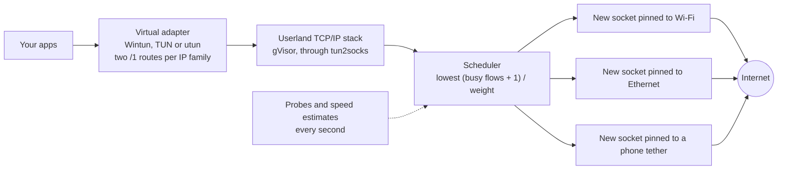

# Developing net-merge

Technical notes for people who want to build, change or understand net-merge. For installing and using it, see the [README](../README.md).

## Command line and flags

```
net-merge on | off        start / pause merging in the running tray
net-merge quit            pause and exit the tray
net-merge status | list   live numbers / which adapters are used and why
net-merge autostart on|off|status
net-merge tray            tray app (asks for admin once)
net-merge run             system-wide in a console window
net-merge socks           plain SOCKS5 proxy on 127.0.0.1:1080 (no admin, per-app)
net-merge cleanup         remove leftover routes after a crash
net-merge install         macOS only: sudo net-merge install, lets the tray start without a password
net-merge version
```

Flags for `tray`/`run`/`socks`: `-include "WiFi,Ethernet"` (only these adapters), `-weight "Name=3"`
(fixed weight instead of measured), `-ipv6 auto|on|off`, `-mtu 9000` (virtual adapter MTU, see below),
`-pprof 127.0.0.1:6060` (Go profiler, loopback only), `-log file`.

## How it works



The app's connection ends inside the userland stack. net-merge then opens a second connection to the real server from the chosen adapter and copies bytes between the two.

### Design trade-offs

- **End each TCP connection and re-dial it, instead of forwarding packets.** A server accepts one sender per connection, so this is the only way to use several links without a server of our own. The cost: one connection never gets faster than one link. Speed comes from many connections.
- **Refuse IPv6 when the adapters differ.** Apps prefer IPv6, so allowing it would send everything to the few adapters that have it. In `auto` mode new IPv6 connections are refused at the first packet and apps fall back to IPv4 at once. The cost: IPv6-only hosts are unreachable until every adapter has IPv6, or until the setting is changed.
- **No speed tests.** Weights come from the traffic that already flows. The cost: a link is measured only while it carries traffic, so an idle estimate can only recover up to half of the best link's speed.

- ON creates a virtual adapter `net-merge` (Wintun on Windows, a kernel TUN on Linux, a utun on macOS) and two `/1` routes per IP family that beat the default route
  without touching it. OFF deletes them. If the process dies the adapter and routes die with it, so a
  crash can't leave the machine without internet.
- Flows entering the TUN are terminated in a userland TCP/IP stack (tun2socks/gVisor) and re-dialed from
  a chosen adapter: the socket is bound to that adapter's source IP and forced out of it with
  `IP_UNICAST_IF` (Windows), `SO_BINDTOIFINDEX` (Linux) or `IP_BOUND_IF` (macOS, plus a scoped default route per adapter so the bound lookup still works), so it can never loop back into the TUN.
- The virtual adapter runs at MTU 9000 (both the OS and the userland stack). Its traffic never leaves
  the machine, so the links' 1500 doesn't apply, and bigger packets cost far less CPU: measured about
  3x less CPU per Mbit/s than at 1500 (0.18 vs 0.54 cores per 100 Mbit/s). `-mtu` changes it.
- Adapters are detected automatically and re-scanned every 3 s. Only real hardware with a default route
  is used (on Linux: interfaces backed by a device in sysfs, with a default route in any routing table; on macOS: `enN` interfaces and TetherKit's `fethN`, with a default route): tunnels, VPNs (Tailscale, WireGuard, ...), virtual switches and LAN-only adapters are skipped
  (`net-merge list` shows why).
- Each adapter and each address family is probed for real internet access. A tether with no data or a
  captive-portal Wi-Fi gets no flows; a recovered link rejoins within seconds.
- Automatic balancing sends flows to the adapter with the lowest (busy flows + 1) / weight,
  discounting TCP sockets with no data for two seconds. Connecting sockets still count as busy.
  Weights update every second from smoothed throughput estimates, separately for IPv4 and IPv6
  (a link can be fast over native IPv6 and slow over translated IPv4). Idle low estimates
  recover up to half the best link's capacity, never to equal preference. Address changes
  reset the affected family's estimate. Static weights retain least-open-flows scheduling;
  scheduling respects health filtering, cooldowns and retry exclusions. Existing flows
  stay pinned to their original adapter; no background speed tests are used.
- IPv6 (`-ipv6 auto|on|off`, tray checkbox): IPv6 flows can only leave through adapters that have IPv6, and
  apps that prefer IPv6 (browsers, OBS, curl) would funnel everything onto them. In `auto` mode IPv6 is
  balanced only when every adapter has working IPv6; otherwise new IPv6 connections are refused at the SYN
  (UDP gets ICMP unreachable), apps fall back to IPv4 instantly, and IPv4 spreads over all adapters.
  Cost: IPv6-only hosts are unreachable while the adapters differ (untick the tray box or use `-ipv6 on`).

## Build

### Windows flyout

`internal/tray/flyout_windows.go` owns a separate Win32 message-loop thread. The existing tray ticker
publishes immutable snapshots to it, and UI actions go back through a buffered channel. The TUN,
probes and scheduler continue independently of the flyout. DWM supplies window corners and accent
color; Segoe Fluent Icons (MDL2 fallback on Windows 10) are system fonts, not redistributed assets.

`internal/provider` pins HTTPS lookup sockets to each adapter, caches results by source address,
and bounds image downloads and raster dimensions. SVG favicons use oksvg/rasterx. Provider lookup
failures fall back to adapter names and system network icons. Display aliases and the public-IP
visibility setting live in `tray-preferences.json`; aliases never rename the Windows interface.

For a read-only preview without a second TUN or changes to merging/adapter settings:

```
net-merge _preview -state-dir <running-tray-state-directory>
```

The preview alone accepts `NET_MERGE_PREVIEW_THEME=light` or `dark` for visual QA; the installed tray
always follows Windows. `net-merge _show` opens the running Windows flyout through its control marker.

### Compiling

Needs Go (see `go.mod`) and, for the Windows installer, [Inno Setup 6](https://jrsoftware.org/isinfo.php).

```
go test ./...                       # uses loopback aliases as fake adapters; no second link needed
go build -o net-merge ./cmd/net-merge   # Linux, macOS (macOS needs the Xcode command line tools)
nix build                           # Linux, with Nix: result/bin/net-merge
scripts\build.ps1 -Version 0.1.0    # dist\: net-merge.exe, net-merge-tray.exe, installer, portable zip
```

`wintun.dll` is not in the repo: `scripts\fetch-wintun.ps1` downloads it and verifies its SHA-256 and its
WireGuard LLC signature. To run from source, put it next to the exe:

```
go build -o net-merge.exe .\cmd\net-merge
scripts\fetch-wintun.ps1 -OutDir .
```

Releases are built by GitHub Actions when a `vX.Y.Z` tag is pushed (`.github/workflows/release.yml`).
Add the version's section to `CHANGELOG.md` first: it becomes the release notes, and the release fails
without it (`scripts\release-notes.ps1 -Version X.Y.Z` previews them).
Layout: `cmd/net-merge` is the command line; `internal/engine` the scheduler, balancer, probes and
SOCKS5 front-end; `internal/nics` adapter discovery, counters and egress pinning; `internal/tun` the
system-wide front-end; `internal/tray` the tray icon; `internal/platform` privileges, single instance
and autostart. OS-specific code lives in `_windows.go` / `_linux.go` / `_darwin.go` files next to the shared code. The
Nix package and NixOS module are in `nix/`; after changing Go dependencies, update `vendorHash` in
`nix/package.nix` (`nix build` prints the new one).

`go test -run xxx -bench Relay ./...` measures the relay data path (about 3 GB/s over loopback).

Don't benchmark against speed.cloudflare.com repeatedly: it rate-limits the IP (HTTP 429) after a few
large downloads and the numbers become meaningless.
